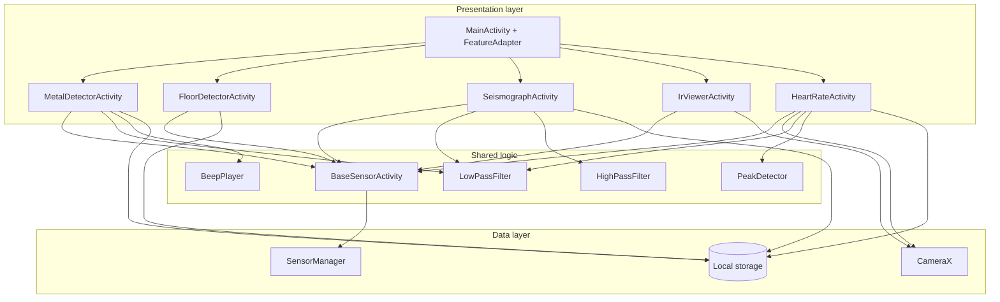
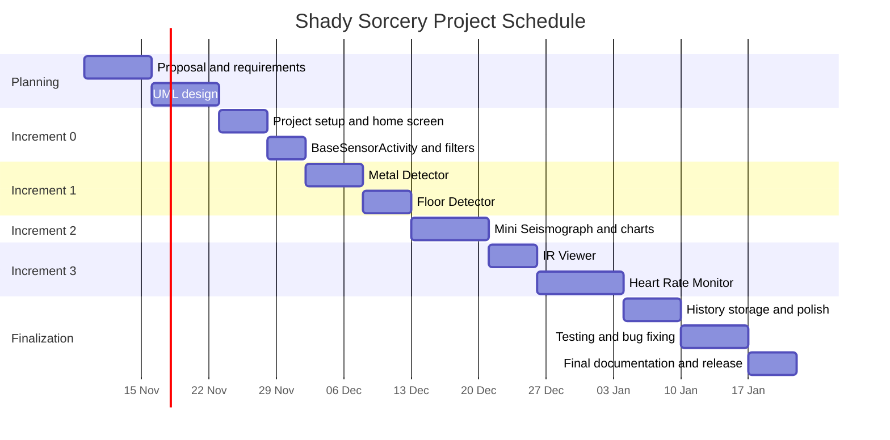
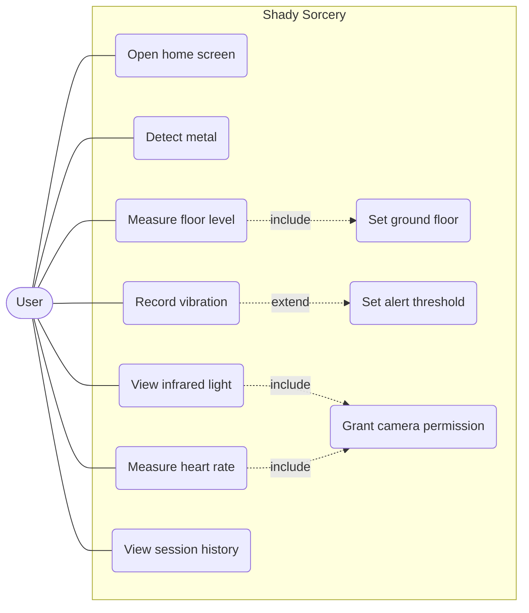
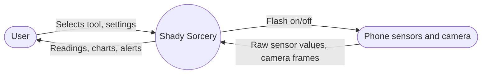
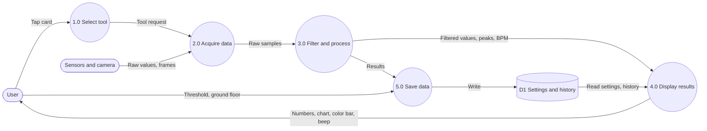
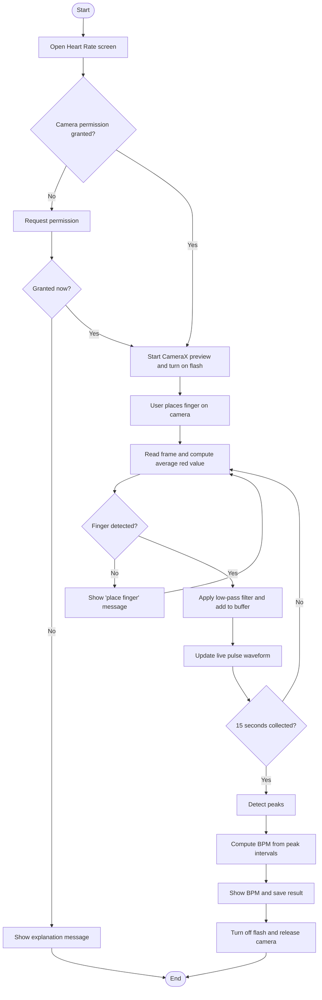
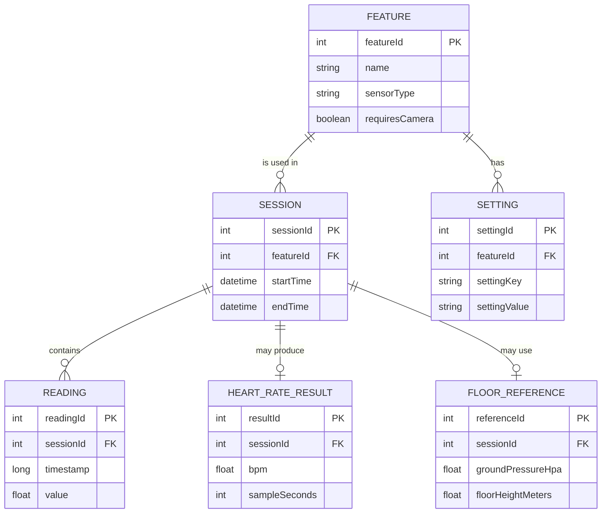
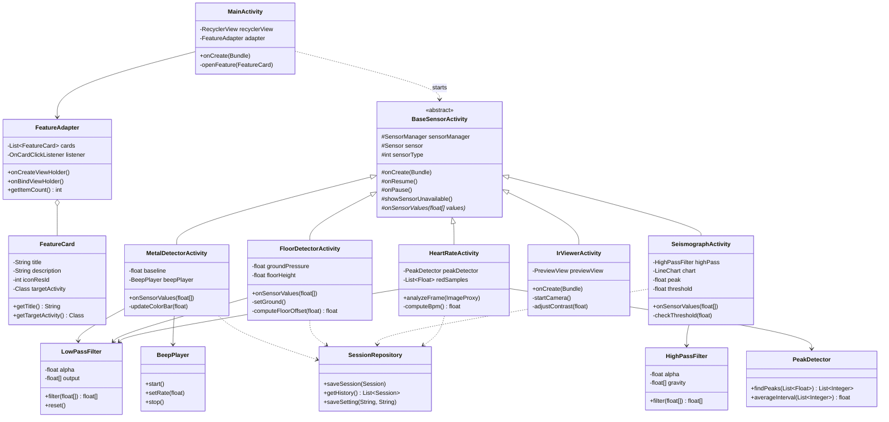
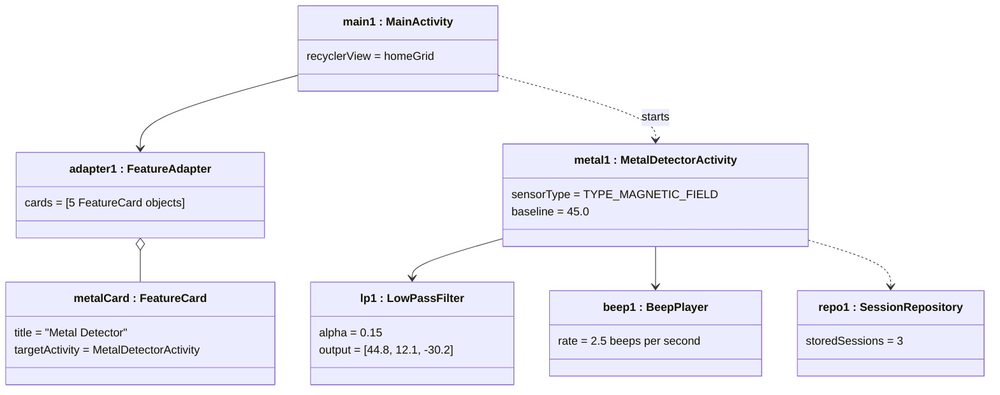

# Shady Sorcery: Project Proposal

**Platform:** Android (Java) | **IDE:** Android Studio | **Minimum SDK:** 26 (Android 8.0)
**Author:** Zahid | **Course:** ICT-2208 (replace if this assignment belongs to a different course)
**Document status:** Initial version of the project proposal

---

## Table of Contents

1. [Introduction](#1-introduction)
2. [Problem Statement](#2-problem-statement)
3. [Objectives](#3-objectives)
4. [Scope](#4-scope)
5. [Stakeholders and Users](#5-stakeholders-and-users)
6. [Requirements](#6-requirements)
7. [Technology Stack](#7-technology-stack)
8. [System Architecture](#8-system-architecture)
9. [Feasibility Study](#9-feasibility-study)
10. [Risk Analysis](#10-risk-analysis)
11. [Software Process Model](#11-software-process-model)
12. [Schedule, Milestones, and Deliverables](#12-schedule-milestones-and-deliverables)
13. [UML Diagrams](#13-uml-diagrams)
14. [Prototype Interface](#14-prototype-interface)
15. [Testing Plan](#15-testing-plan)
16. [Conclusion](#16-conclusion)
17. [References](#17-references)

---

## 1. Introduction

Shady Sorcery is an Android application that turns the sensors already built into a smartphone into five small measurement tools. The home screen shows five cards. Each card opens one tool:

| # | Tool | Hardware used | What it does |
|---|------|---------------|--------------|
| 1 | Metal Detector | Magnetometer (`TYPE_MAGNETIC_FIELD`) | Shows the magnetic field strength in µT and warns when it rises near metal objects |
| 2 | Floor Detector | Barometer (`TYPE_PRESSURE`) | Shows how many floors the user is above or below a chosen ground floor |
| 3 | Mini Seismograph | Accelerometer (`TYPE_ACCELEROMETER`) | Draws vibration on a live chart and records the peak value |
| 4 | IR Viewer | Front camera (CameraX) | Shows a live preview that can reveal the infrared light of a remote control |
| 5 | Heart Rate Monitor | Rear camera and flash (CameraX) | Estimates beats per minute from a fingertip placed over the camera |

The app needs no internet connection and requests only the `CAMERA` permission.

## 2. Problem Statement

Smartphones contain many sensors, but most users never see their data. Separate apps exist for each task (compass, metal detector, heart rate, vibration meter). They are often full of advertisements, ask for unnecessary permissions, and each one must be installed separately.

This project provides one small, ad-free application that groups several sensor tools and shows the raw sensor behavior in a clear way. It also serves as a learning project for working with the Android sensor framework, CameraX, signal filtering, and real-time charts.

## 3. Objectives

1. Build a single Android application with a home screen and five sensor tools.
2. Share common behavior (sensor registration, lifecycle handling, unavailable-sensor messages, signal smoothing) through a base class and a utility class, so that code is not repeated.
3. Display live sensor data with numbers, color indicators, and charts.
4. Handle devices that lack a sensor by showing a clear message instead of crashing.
5. Request only the permission that is required (`CAMERA`).
6. Document the design using standard UML diagrams and a software process model.

## 4. Scope

### In scope

- Five sensor tools listed in the introduction.
- A home screen with cards that start each tool.
- Low-pass and high-pass filtering of sensor values.
- Live charts using MPAndroidChart.
- Local storage of settings and a short history of sessions on the device.
- Support for Android 8.0 (API 26) and later.

### Out of scope

- Cloud storage, user accounts, or any server component.
- Medical-grade accuracy. The heart rate tool is for general information only and is not a medical device.
- Real earthquake detection or early warning.
- Detecting non-magnetic metals such as aluminum, gold, or copper reliably (a magnetometer responds mainly to iron, steel, and magnets).
- iOS or tablet-specific layouts.

### Known hardware limits (to be stated in the app)

- Many phones have no barometer. Many front cameras include an infrared filter, so the IR Viewer works only on some devices and only with strong sources such as TV remotes.
- A barometer changes by roughly 0.12 hPa per meter of height, so floor estimates have an error of one or two meters and can drift with weather.

## 5. Stakeholders and Users

| Stakeholder | Interest |
|-------------|----------|
| Developer (Zahid) | Designs, builds, tests, and documents the app |
| Course instructor | Evaluates the proposal, design, and prototype |
| General phone users | Use the tools out of curiosity or for simple tasks |
| Students and hobbyists | Study how phone sensors behave |

## 6. Requirements

### 6.1 Functional requirements

| ID | Requirement |
|----|-------------|
| FR-01 | The home screen shall show five cards, one for each tool. |
| FR-02 | Tapping a card shall open the matching tool screen. |
| FR-03 | Each tool shall register its sensor when the screen is visible and unregister it when the screen is hidden. |
| FR-04 | If the required sensor is missing, the tool shall show a "sensor not available" message. |
| FR-05 | The Metal Detector shall show the field strength in µT, a green/yellow/red bar, and an optional beep whose speed increases with strength. |
| FR-06 | The Floor Detector shall let the user set the current floor as ground and then show the floor offset using `SensorManager.getAltitude()`. |
| FR-07 | The Mini Seismograph shall apply a high-pass filter, draw a live line chart, show the peak value, and raise an alert when a user-set threshold is exceeded. |
| FR-08 | The IR Viewer shall show a live front-camera preview with a contrast/brightness control and an information text about remote controls. |
| FR-09 | The Heart Rate Monitor shall turn on the flash, measure the average red channel of each camera frame, detect peaks over 15 seconds, and show BPM and a live pulse waveform. |
| FR-10 | The app shall ask for the `CAMERA` permission before opening the IR Viewer or the Heart Rate Monitor, and shall explain what happens if the user refuses. |
| FR-11 | The app shall save settings (threshold, beep on/off) and a short history of results on the device. |

### 6.2 Non-functional requirements

| ID | Category | Requirement |
|----|----------|-------------|
| NFR-01 | Performance | Charts shall update at least 10 times per second without visible lag. |
| NFR-02 | Reliability | The app shall not crash when a sensor or the camera is unavailable. |
| NFR-03 | Usability | Each tool shall be usable within two taps from the home screen. |
| NFR-04 | Privacy | Camera frames shall be processed in memory and never saved or sent anywhere. |
| NFR-05 | Compatibility | The app shall run on Android 8.0 (API 26) and later. |
| NFR-06 | Battery | Sensors, camera, and flash shall be released when a tool screen is not in the foreground. |
| NFR-07 | Maintainability | Shared logic shall be placed in `BaseSensorActivity` and utility classes. |

## 7. Technology Stack

| Area | Choice |
|------|--------|
| Language | Java |
| UI | XML layouts, RecyclerView with cards |
| Sensors | `SensorManager` (Android framework) |
| Camera | CameraX (Java API) |
| Charts | MPAndroidChart |
| Local storage | `SharedPreferences` for settings, SQLite (Room) for session history |
| Build | Gradle, Android Studio |
| Version control | Git and GitHub |
| Permission | `CAMERA` only |

## 8. System Architecture

The app uses a simple layered design. `MainActivity` shows the home screen. Each feature is its own Activity that extends `BaseSensorActivity`. The base class handles the sensor lifecycle and the fallback message. Shared signal processing is in utility classes.



## 9. Feasibility Study

| Type | Assessment |
|------|------------|
| Technical | All required APIs (SensorManager, CameraX, MPAndroidChart) are free, documented, and work with Java. |
| Economic | No cost beyond a development computer and one Android phone. All tools and libraries are free. |
| Schedule | Ten weeks is enough for five small features when they are built in increments (see Section 12). |
| Operational | The app is standalone and needs no server, so there is no running cost after release. |
| Legal | No personal data leaves the device. The heart rate screen includes a "not a medical device" notice. |

## 10. Risk Analysis

| ID | Risk | Likelihood | Impact | Mitigation |
|----|------|-----------|--------|------------|
| R1 | Test phone lacks a barometer or has an IR filter on the front camera | Medium | Medium | Show a fallback message; test on an emulator with virtual sensors and on at least one real phone |
| R2 | Heart rate readings are noisy | High | Medium | Low-pass filter, require a still finger, show a "signal too weak" message |
| R3 | Magnetometer readings are disturbed by the phone's own parts | Medium | Low | Provide a "calibrate" (zero) button that subtracts the background field |
| R4 | Delays from learning CameraX | Medium | Medium | Build the camera features last, after the sensor features work |
| R5 | Battery drain from flash and camera | Low | Low | Release resources in `onPause()`; stop measuring after the 15-second window |
| R6 | Schedule slips because of other coursework | Medium | Medium | Keep a buffer week; features are ordered so the least important can be cut |

## 11. Software Process Model

**Chosen model: Incremental model with iterative development.**

### Reason for the choice

- The project has five features that are mostly independent. Each can be built, tested, and demonstrated as one increment.
- The shared base (home screen, `BaseSensorActivity`, `LowPassFilter`) is built first, so later increments reuse it.
- The requirements are already clear, so a plan-driven approach works. A pure waterfall model would delay all testing to the end, which is risky for sensor behavior that can only be checked on a real device.
- A single developer does not need the meeting overhead of Scrum, but the short build-test-review cycle of agile development is still useful.

### Increments

| Increment | Content | Result |
|-----------|---------|--------|
| 0. Foundation | Project setup, home screen, `BaseSensorActivity`, `LowPassFilter`, settings | App launches and cards open empty tool screens |
| 1. Basic sensors | Metal Detector, Floor Detector | Two working tools |
| 2. Charting | Mini Seismograph, `HighPassFilter`, MPAndroidChart | Live chart tool |
| 3. Camera | IR Viewer, Heart Rate Monitor, `PeakDetector` | All five tools |
| 4. Finalization | History storage, polish, full testing, documentation | Release candidate |

Each increment follows the same short cycle: **plan, design, implement, test, review**.

## 12. Schedule, Milestones, and Deliverables

The dates below assume a start on 9 November 2026 and a finish in mid-January 2027. Adjust them to the real course calendar.

### 12.1 Gantt chart



### 12.2 Milestones

| ID | Milestone | Target week | Completion criterion |
|----|-----------|-------------|----------------------|
| M1 | Proposal and UML complete | Week 2 | README with all diagrams pushed to GitHub |
| M2 | Foundation ready | Week 4 | Home screen opens placeholder tool screens |
| M3 | Basic sensors done | Week 6 | Metal Detector and Floor Detector work on a device |
| M4 | Charting done | Week 7 | Seismograph shows live chart, peak, and alert |
| M5 | Camera features done | Week 9 | IR Viewer and Heart Rate Monitor work on a device |
| M6 | Release candidate | Week 10 | All test cases pass; final report and APK delivered |

### 12.3 Deliverables

| # | Deliverable | Due with |
|---|-------------|----------|
| D1 | Project proposal (this README) with UML diagrams | M1 |
| D2 | Source code repository on GitHub | M2 onward |
| D3 | Working prototype of the home screen and at least five classes | M2 |
| D4 | Tested sensor features (Increments 1 and 2) | M4 |
| D5 | Tested camera features (Increment 3) | M5 |
| D6 | Test report | M6 |
| D7 | Signed debug APK and user guide | M6 |
| D8 | Final report (LaTeX/PDF version of this document) | M6 |

## 13. UML Diagrams

All diagrams are written in Mermaid, which GitHub renders automatically.

### 13.1 Use Case Diagram



### 13.2 Data Flow Diagram

**Level 0 (context diagram)**



**Level 1**



### 13.3 Activity Diagram (Heart Rate Monitor)



### 13.4 Entity Relationship Diagram

The app has no server, but it stores settings and a short history on the device. These stored items are the entities.



### 13.5 Class Diagram



### 13.6 Object Diagram

This diagram shows one possible moment at run time: the user has opened the Metal Detector while the heart rate and floor tools are not running.



## 14. Prototype Interface

The first prototype is a simple interface built with the classes from the class diagram. It covers the home screen and one working tool screen, so that the shared base design can be tested early (Milestone M2).

### 14.1 Classes used in the prototype

| Class | Role in the prototype |
|-------|-----------------------|
| `MainActivity` | Shows the home grid and starts a tool screen when a card is tapped |
| `FeatureCard` | Holds the title, description, icon, and target Activity of one card |
| `FeatureAdapter` | Connects the list of `FeatureCard` objects to the RecyclerView |
| `BaseSensorActivity` | Registers and unregisters the sensor and shows the "sensor not available" message |
| `LowPassFilter` | Smooths the magnetometer values |
| `MetalDetectorActivity` | First complete tool: µT number and color bar |

This is six classes, which meets the requirement of at least five.

### 14.2 Screens

```
+---------------------------+      +---------------------------+
|       Shady Sorcery       |      |  < Metal Detector         |
|                           |      |                           |
| +-----------+ +---------+ |      |          52.4 µT          |
| | Metal     | | Floor   | |      |                           |
| | Detector  | | Detector| |      |  [=======>          ]     |
| +-----------+ +---------+ |      |   green  yellow  red      |
| +-----------+ +---------+ |      |                           |
| | Mini      | | IR      | |      |  [ Zero / Calibrate ]     |
| | Seismo.   | | Viewer  | |      |  [x] Beep                 |
| +-----------+ +---------+ |      |                           |
| +-----------+             |      |  Note: detects mainly     |
| | Heart Rate|             |      |  iron and steel.          |
| +-----------+             |      |                           |
+---------------------------+      +---------------------------+
          Home screen                    Metal Detector screen
```

### 14.3 Planned source layout

```
app/src/main/
├── java/com/example/shadysorcery/
│   ├── MainActivity.java
│   ├── FeatureCard.java
│   ├── FeatureAdapter.java
│   ├── BaseSensorActivity.java
│   ├── MetalDetectorActivity.java
│   ├── FloorDetectorActivity.java
│   ├── SeismographActivity.java
│   ├── IrViewerActivity.java
│   ├── HeartRateActivity.java
│   └── util/
│       ├── LowPassFilter.java
│       ├── HighPassFilter.java
│       ├── PeakDetector.java
│       └── BeepPlayer.java
└── res/layout/
    ├── activity_main.xml
    ├── item_feature_card.xml
    └── activity_metal_detector.xml
```

## 15. Testing Plan

| Level | What is tested | Method |
|-------|----------------|--------|
| Unit | `LowPassFilter`, `HighPassFilter`, `PeakDetector`, floor offset calculation | JUnit tests with known input arrays |
| Integration | `BaseSensorActivity` registers and unregisters correctly when the screen is paused and resumed | Manual check with Logcat |
| System | Each tool on a real phone | Test cases below |
| Compatibility | Android 8.0, a recent Android version, and a device without the needed sensor | Emulator and physical device |
| Usability | A classmate completes each tool without help | Informal observation |

### Sample test cases

| ID | Test | Expected result |
|----|------|-----------------|
| TC-01 | Tap each of the five cards | The matching screen opens |
| TC-02 | Open Metal Detector on a device without a magnetometer | "Sensor not available" message, no crash |
| TC-03 | Move the phone near a steel object | µT value rises and the bar changes color |
| TC-04 | Set ground, then move one floor up | Floor offset is about +1 |
| TC-05 | Shake the phone on a table | Seismograph chart shows a peak and the alert triggers above the threshold |
| TC-06 | Refuse the camera permission | Explanation is shown and the app does not crash |
| TC-07 | Place a finger on the camera for 15 seconds | BPM is shown and is within 10 BPM of a manual count |
| TC-08 | Press Home during the heart rate test | Flash and camera are released |

## 16. Conclusion

Shady Sorcery is a small project with a clear structure: one home screen, five tools, one base class, and a few shared utility classes. The incremental process model fits the work because each tool can be built and tested on its own. The main technical risks are device differences in sensors and noise in camera-based measurements, and the plan addresses them with fallback messages, filtering, and a testing schedule that uses a real device.

## 17. References

1. Android Developers. *Sensors Overview*. https://developer.android.com/develop/sensors-and-location/sensors/sensors_overview
2. Android Developers. *CameraX Overview*. https://developer.android.com/media/camera/camerax
3. Android Developers. *SensorManager.getAltitude()*. https://developer.android.com/reference/android/hardware/SensorManager
4. PhilJay. *MPAndroidChart*. https://github.com/PhilJay/MPAndroidChart
5. Sommerville, I. *Software Engineering*, 10th ed. Pearson, 2016.
6. Pressman, R. S. and Maxim, B. *Software Engineering: A Practitioner's Approach*, 9th ed. McGraw-Hill, 2020.
